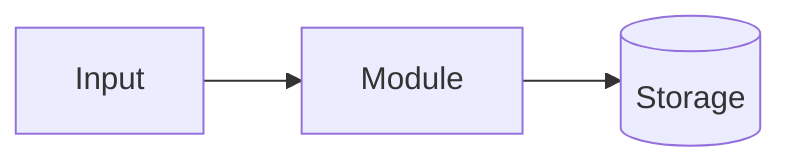

# <Project> — Architecture

> **Last updated:** YYYY-MM-DD · refreshed with `ARCHITECTURE`

## 1 · Overview

One paragraph: what the system does, who or what uses it, what it calls, what it stores.

## 2 · Modules

One row per top-level folder or package. Add rows when modules are added; never rename one
silently.

| Module | Responsibility (one line) | Used by | Depends on |
|--------|---------------------------|---------|------------|
| `<folder>` | | | |

## 3 · Boundaries

Rules about which module may use which. Changing one needs an ADR.

- [e.g. `core/` never imports from `api/`.]

## 4 · Data flow

## 5 · External dependencies

Every external service, database or major library. Each one has an ADR.

| Dependency | Purpose | ADR |
|------------|---------|-----|
| | | [ADR-NNNN](decisions/NNNN-slug.md) |

## 6 · Change log

One line per change of structure, newest last.

- YYYY-MM-DD — [what changed] ([spec](features/…) / [ADR](decisions/…))
