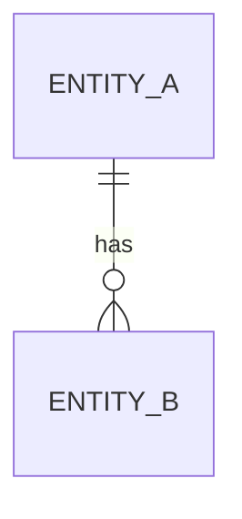

# <Project> — Data model

> **Last updated:** YYYY-MM-DD

What the system stores, and the rules that keep it consistent. Update it with every change of
a stored shape.

## Entities

| Entity | Meaning | Key | Stored in |
|--------|---------|-----|-----------|
| `<Entity>` | | | |

## Fields

### `<Entity>`

| Field | Type | Required | Rules |
|-------|------|----------|-------|
| `id` | | yes | |

## Relationships

## Changes to stored data

How a change of shape reaches existing data (migration script, versioned files, …), newest last.

- YYYY-MM-DD — [change] ([spec](features/…))
